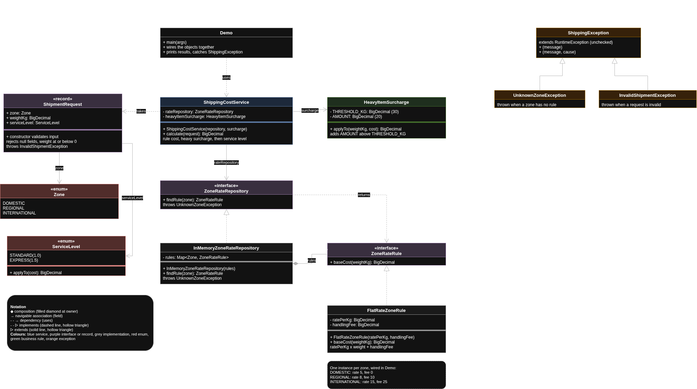

# Tidewater Freight: Analysis and Decisions

## Legend

**Sources**
- **AmaliTech Coding Standards**: *AmaliTech Coding Standards: Java Edition*, the company standard. "§6.1" means section 6.1 of that document.
- **Google testable-code guide**: *Guide to Writing Testable Code*, Google Testing Blog (2008). It names four design flaws that make code hard to test:
  - flaw 1, a constructor that does real work
  - flaw 2, digging into collaborators
  - flaw 3, global state
  - flaw 4, a class that does too much
- **Fowler**: Ham Vocke, *The Practical Test Pyramid* (martinfowler.com).
- **Baeldung / dev.java**: *Custom Exceptions in Java* (Baeldung) and *Throwing Exceptions* (dev.java).

**Terms**
- **SOLID**: five object-oriented design principles. The three used here:
  - **SRP**, Single Responsibility Principle: a class has one reason to change.
  - **OCP**, Open-Closed Principle: new behaviour is added by adding code, not by editing existing code.
  - **DIP**, Dependency Inversion Principle: a class depends on an interface and is handed its collaborators, rather than creating them itself.
- **Code smells** named here:
  - **Primitive Obsession**: a plain `String` or `double` used where a proper type belongs.
  - **Shotgun Surgery**: one change forces small edits in many places.
  - **Switch Statements**: a type-based `if/else` chain that should be polymorphism.
- **Mutation testing / PIT**: a tool that breaks the code in small ways (each break is a **mutant**) and re-runs the tests. A mutant that no test catches has **survived**, which means the tests are weak.
- **C1 to C12** are my numbering for the code findings. **T1 to T3** are my numbering for the AI-written tests. Neither is part of any standard.

---

## Part 1: Analysis

### 1. Baseline

- **Environment:** Java 21.0.13 (Temurin), Maven 3.9.12, JUnit 5.13.4, Mockito 5.18.0.
- **Original suite:** `mvn clean test` ran 3 tests, all green, BUILD SUCCESS.
- **What the service does:** it calculates the cost of a shipment from its zone, its weight in kg and its service level (STANDARD or EXPRESS), applying the company's rate rules.
- **Original behaviour** (saved in `ORIGINAL_OUTPUT.txt`):
  - DOMESTIC, 10 kg, STANDARD gives 50.0
  - INTERNATIONAL, 40 kg, EXPRESS gives 967.5
  - Unknown zone MOON, 10 kg gives 0.0, with no error and no log line
- **Pricing rules, in the order they are applied:**
  1. Base = zone rate per kg x weight (DOMESTIC 5, REGIONAL 8, INTERNATIONAL 15)
  2. Zone fee (REGIONAL +10, INTERNATIONAL +25, DOMESTIC +0)
  3. Heavy-item surcharge (+20 if weight is over 30 kg)
  4. EXPRESS multiplies the running total by 1.5
- **Mutation testing on the original code** (PIT 1.16.1, before any change): 64% line coverage (21/33 lines), 17% mutation coverage (3 of 18 mutants killed, 15 survived), 27% test strength (3 of the 11 mutants the tests executed were killed).

### 2. Code smells and SOLID violations

Section references are to the AmaliTech Coding Standards: Java Edition. Where the standard is silent, the table says so.

| # | Finding | Where | Principle or standard broken | Why it matters |
|---|---|---|---|---|
| C1 | `catch (Exception e) { return 0; }` hides every failure. An unknown zone, a bad input or a bug all become a price of 0. | `ShippingCalculator.calculateCost` | AmaliTech §6.1 (never swallow a failure); §6.3 (add context, keep the cause) | A shipment is quoted for free and nobody is told. |
| C2 | No input validation. A negative weight gives a negative cost, zero weight still charges the zone fee, NaN passes through, and an unrecognised service level such as `"express"` is priced as STANDARD. | `calculateCost` | General defensive-programming practice: reject invalid input at the entry point (fail fast). Not stated in the AmaliTech standard or the Google guide. | Wrong money with no signal. |
| C3 | The rate source is hard-wired: `new InMemoryRateRepository()` in a field initialiser. The interface exists, but nothing can inject another implementation. | `ShippingCalculator` field | DIP; AmaliTech §12.5; Google guide, flaw 1 | No fake can replace the rates, so the class is hard to test. |
| C4 | One class does five jobs: rate lookup, zone fees, heavy surcharge, express multiplier and console output. | `ShippingCalculator` | SRP; AmaliTech §12.1; AmaliTech §4.2 (a method does one thing); Google guide, flaw 4 | It has several reasons to change, and no rule can be tested alone. |
| C5 | Zone knowledge is split across two places. The rate lives in the repository and the fee lives in an `if / else if` chain in the calculator. A zone added to only one of them gets a rate and no fee, or the reverse. | `calculateCost`, `InMemoryRateRepository` | OCP; AmaliTech §12.2. Smells: Switch Statements, Shotgun Surgery. | This is the coming change, and today it forces edits in two places. |
| C6 | `double` is used for money, and EXPRESS is applied as a floating-point `* 1.5`. | Whole service | Not in the AmaliTech standard. Common Java practice: `double` cannot represent many decimal fractions exactly, so money belongs in `BigDecimal`. | Rounding error can change a price. |
| C7 | Magic numbers (`10`, `25`, `30`, `20`, `1.5`) and magic strings (`"DOMESTIC"`, `"EXPRESS"`). | `calculateCost` | AmaliTech §3.4 (searchable names, no magic numbers) | A typo silently skips a rule. |
| C8 | `System.out.println` inside the business method. It prints only on success, so MOON prints nothing. | `calculateCost` | AmaliTech §4.4 (no hidden side effects); §8 (objects) | Presentation is mixed with logic. |
| C9 | Zone and service level are plain `String`s (Primitive Obsession), and the method takes three parameters. | Method signature | AmaliTech §4.3 (few arguments) | A typo compiles and is only found at run time, if ever. |
| C10 | An empty `if (DOMESTIC) { // no extra fee }` branch, and comments that restate the code. | `calculateCost` | AmaliTech §10 (comment only the why; no dead code) | Noise that hides the real rules. |
| C11 | The repository throws a bare `IllegalArgumentException("Unknown zone")`. There is no custom exception, so a caller cannot tell an unknown zone from an unrelated bug. | `InMemoryRateRepository` | Not in the AmaliTech standard. General practice (Baeldung, dev.java): custom exception types for related business failures. | Failures cannot be handled specifically. |
| C12 | Rates are hard-coded in the constructor, with no way to register a zone from outside. | `InMemoryRateRepository` | OCP; AmaliTech §12.2 | Adding a zone means editing this class. |

### 3. Hollow AI-written tests

These are separate from the code findings. Each test is checked against one question: *if I broke the pricing rule, would this go red?*

| Test | What it claims | Why it proves nothing | Category | Would a broken rule turn it red? |
|---|---|---|---|---|
| T1 `calculatesExpressCost` | Express cost for INTERNATIONAL 40 kg is 967.5 | It creates a Mockito mock of `ShippingCalculator`, tells the mock to return 967.5, then asserts the mock returns 967.5. The real pricing code never runs. | Verifies only a mock; tests the stub, not the code | No. An empty method body would still pass. |
| T2 `returnsACostForAShipment` | A cost comes back | It calls `assertNotNull` on a primitive `double`, which is boxed and can never be null. It never checks the value. | Asserts nothing that can fail | No. |
| T3 `calculatesACost` | Domestic cost is correct | It asserts only `cost > 0`, which passes for 50.0, 51.0 or 9999.0. It covers only the DOMESTIC path. | Happy path only, with a weak assertion | Only if the cost became zero or negative. A changed rate or fee stays green. |

**Not tested at all:** exact values; the REGIONAL and INTERNATIONAL fees; the 30 kg boundary (30 vs 30.01); EXPRESS applied after the surcharge; an unknown zone; an invalid weight; null inputs.

**Rule broken:** AmaliTech §9 requires assertions that would fail if the behaviour were wrong. Fowler's *Practical Test Pyramid* says tests should check the observable result for a given input, not that a stub returns what it was told to.

**Measured:** PIT broke the original code 18 times and the suite caught only 3. The lines the tests do execute are barely checked (test strength 27%). The suite proves very little, whatever its green build suggests.

### 4. Ranking

1. **T1 to T3, the hollow tests (single most serious problem).** The safety net is the thing meant to catch C1, C2 and C5, and it cannot. A green build says nothing about correctness, so the team believes the code works when it has never been checked. This is why the swallowed failure in C1 went unnoticed, and it makes every other finding harder to catch.
2. **C1, the swallowed failure.** Every error becomes a plausible price of 0, so a bad shipment goes out free with no signal.
3. **C5, the split zone knowledge.** It directly blocks the coming change.
4. **C2 and C3.** No validation, and a hard-wired dependency that blocks testing.
5. **C4, C6, C8, C9, C11, C12.**
6. **C7, C10.**

---

## Part 2: Decisions

### Key design decisions

| Decision | Chosen | Rejected | Why |
|---|---|---|---|
| Zone rules | `ZoneRateRule` interface, implemented by `FlatRateZoneRule` with values per zone | Keep the `if` chain in one class | Each zone's formula is its own object, so a new zone adds code and does not edit the old logic (OCP). |
| Dependencies | Constructor injection of `ZoneRateRepository` and `HeavyItemSurcharge` | `new` inside the class (the original) | A test can pass a fake or a real rule. Fixes C3 (DIP). |
| Money | `BigDecimal`, rounded `HALF_UP` to 2 decimal places | `double` | Exact decimal arithmetic. Fixes C6. |
| Zone and service level | `enum`s | `String` | A typo cannot compile. Fixes C9. Trade-off: adding a zone edits the enum (see below). |
| Input validation | `ShipmentRequest` record validates in its constructor | Check inside the service | An invalid request cannot exist, so the service never receives one. Fixes C2. |
| Surcharge | Separate `HeavyItemSurcharge` class | Inline `if` in the service | Its 30 kg boundary can be tested alone (SRP, fixes C4). |
| Output | Moved to `Demo` | `println` in the calculation | Presentation is separate from logic. Fixes C8. |
| Order of pricing steps | Base, zone fee, surcharge, then service level | Service level applied first | Kept from the original, so EXPRESS multiplies the surcharge too. |

### Proposed design



Editable source: `class-design.drawio`

- `ShippingCostService` is the single orchestrator, with its two collaborators injected through the constructor.
- `ShipmentRequest` is a record that validates itself, so an invalid request cannot exist.
- `ZoneRateRule` and `ZoneRateRepository` are interfaces, with `FlatRateZoneRule` and `InMemoryZoneRateRepository` as implementations.
- `Zone` and `ServiceLevel` are enums.
- `HeavyItemSurcharge` is a separate class, so the 30 kg boundary can be tested alone.
- A `ShippingException` hierarchy of unchecked exceptions.

### How the design absorbs the coming change

Adding a zone, COASTAL, with its own rate and fee takes three steps:

```java
// 1. Zone.java: one new constant. parseZone() accepts it automatically.
public enum Zone { DOMESTIC, REGIONAL, INTERNATIONAL, COASTAL; /* ... */ }

// 2. Only if COASTAL uses a different formula: a new class implementing ZoneRateRule.
//    Otherwise, reuse FlatRateZoneRule with new values.

// 3. Demo.java (the wiring): one map entry.
Zone.COASTAL, new FlatRateZoneRule(new BigDecimal("6"), new BigDecimal("5"))
```

`ShippingCostService`, `HeavyItemSurcharge`, `ShipmentRequest` and the exception classes are not edited. The service looks up the zone's rule through the repository, so it contains no `if` for zones.

**Honest limit:** step 1 edits `Zone.java`, so the change is not zero edits. The enum is the one place a new zone is recorded. Loading zones from configuration would avoid even that edit, but I rejected it for this scope because it moves validation from compile time to run time.

### Kept, fixed or rewrote

| AI code or test | Action | Reason | How it is checked |
|---|---|---|---|
| Rate values (5, 8, 15) and zone fees (+10, +25) | Kept | Business rules, now held in `FlatRateZoneRule` and the `Demo` wiring | `ShippingCostServiceTest.realRulesGiveTheOriginalInternationalExpressPrice` (967.50); `FlatRateZoneRuleTest` |
| 30 kg surcharge (+20) | Kept | Same rule, now in `HeavyItemSurcharge` | `HeavyItemSurchargeTest` at 29.99, 30 and 30.01 |
| EXPRESS multiplier (1.5), applied after the surcharge | Kept | Same order as the original | `ShippingCostServiceTest.appliesServiceLevelAfterSurcharge` (180, not 170) |
| `ShippingCalculator` class | Rewrote | Does five jobs (C4) | Replaced by `ShippingCostService` and its collaborators |
| `return 0` on any failure | Rewrote | Hides failures (C1) | `ShippingCostServiceTest.unknownZoneFailsLoudlyAndNeverReturnsZero` |
| `System.out.println` in the calculation | Rewrote | Mixes presentation and logic (C8) | Output now comes only from `Demo` |
| `double` money | Rewrote | Rounding error (C6) | `ShippingCostServiceTest.roundsHalfUpToTwoDecimals` |
| Hard-wired `InMemoryRateRepository` | Fixed | Cannot be replaced (C3) | Constructor injection; `ShippingCostServiceTest` uses a Mockito mock of the repository |
| `calculatesExpressCost` (T1) | Rewrote | Mocked the class under test | Replaced by exact-value tests on the real service |
| `returnsACostForAShipment` (T2) | Deleted | Asserted `notNull` on a primitive | Exact values are asserted in the service tests instead |
| `calculatesACost` (T3) | Rewrote | Asserted only `> 0` | `ShippingCostServiceTest`, exact expected values |

### Exception handling

- **`ShippingException`**: the unchecked base class for every shipping failure, so callers can handle the whole family with one catch.
- **`UnknownZoneException extends ShippingException`**: thrown by the repository when a zone has no rule. The message names the zone.
- **`InvalidShipmentException extends ShippingException`**: thrown by `ShipmentRequest` for a missing field or a non-positive weight, and by `Zone.parseZone` for an unknown name. When it wraps another exception, it keeps that exception as the cause.
- **Where I catch:** `Zone.parseZone` converts the `IllegalArgumentException` from `Enum.valueOf` into `InvalidShipmentException`, keeping the original as the cause. `Demo` catches `ShippingException` and reports it on stderr. The service does not catch, because it has nothing useful to do with the failure.
- **Nothing is swallowed.** Each failure either propagates, or is reported at the boundary with its cause kept.
- **Known gap:** `Zone.parseZone(null)` throws `NullPointerException`, not `InvalidShipmentException`. The current flow never passes null, because `ShipmentRequest` rejects a null zone first. The fix is a null check and a test, to be added in a separate commit.

### My one improvement: PIT mutation testing

PIT changes the code in small ways (for example `> 30` to `>= 30`, or `HALF_UP` to `HALF_EVEN`) and checks whether any test fails. It targets the failure this lab is about: tests that stay green without checking anything.

- **Before (original suite):** 17% mutation coverage, 3 of 18 mutants killed.
- **After (refactored suite):** 55% mutation coverage (16 of 29 killed), test strength 94% (16 of 17 covered mutants killed), line coverage 65% (44/68).
- **Caveat:** The denominators differ because the refactor has more classes, so test strength is the fairer comparison.
- **Open item:** one boundary mutant survived (ConditionalsBoundaryMutator). Not yet investigated. 12 mutants have no coverage, which PIT reports for code no test executes, including `Demo`, which is not excluded from PIT.

Any surviving mutant after the refactor points to a test that needs a stronger assertion. The surviving mutants will be listed here with the test that was strengthened in response.
